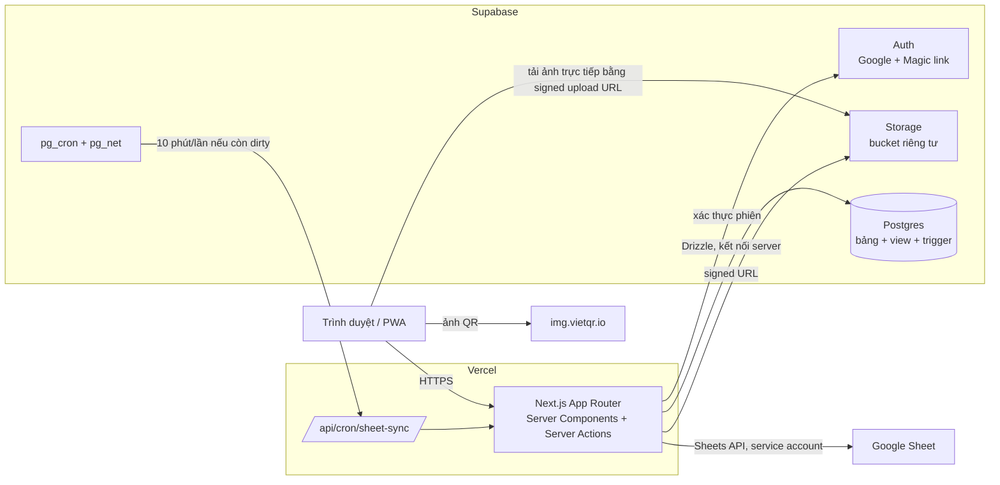
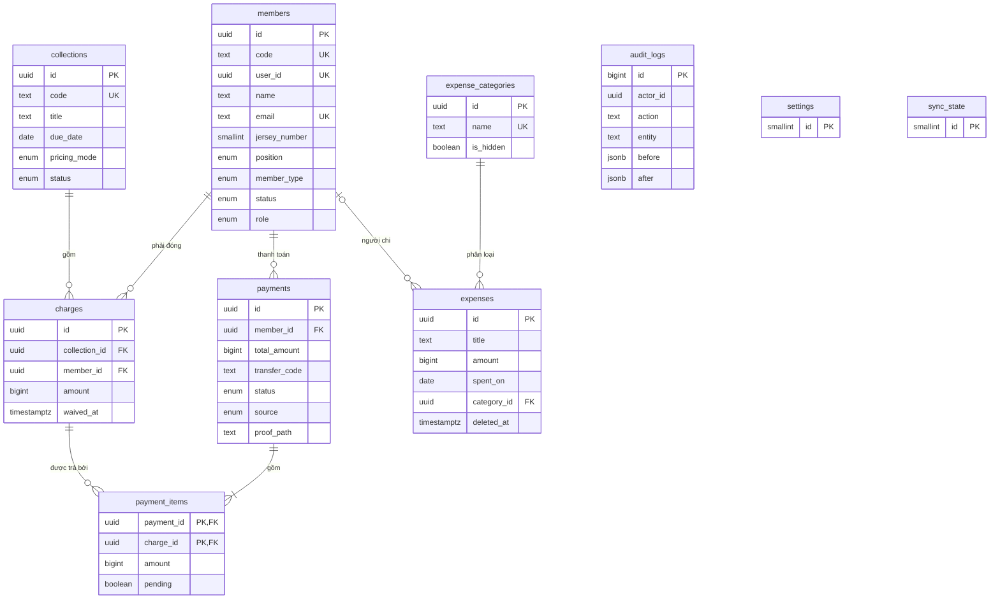
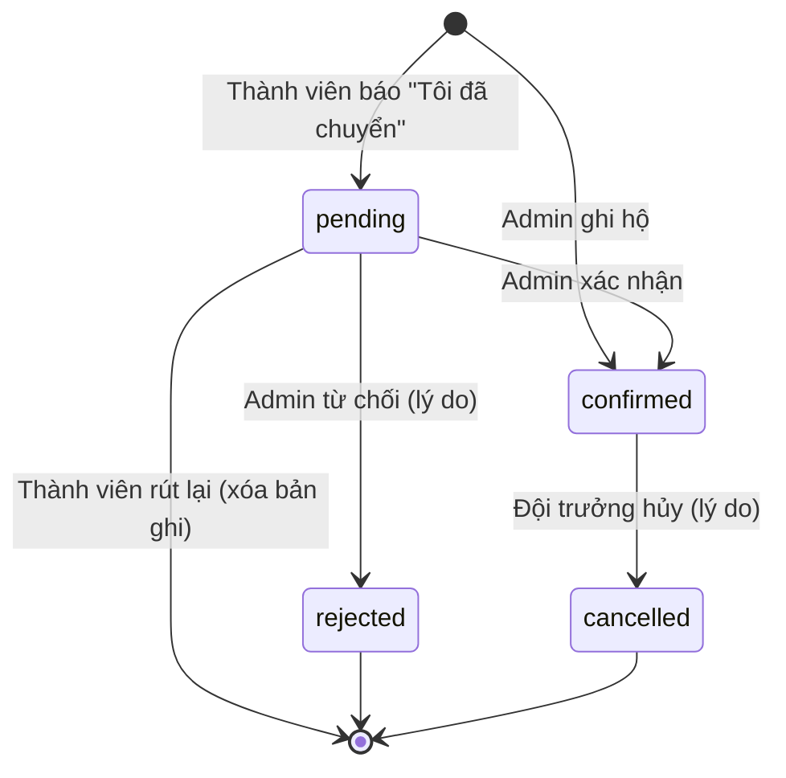
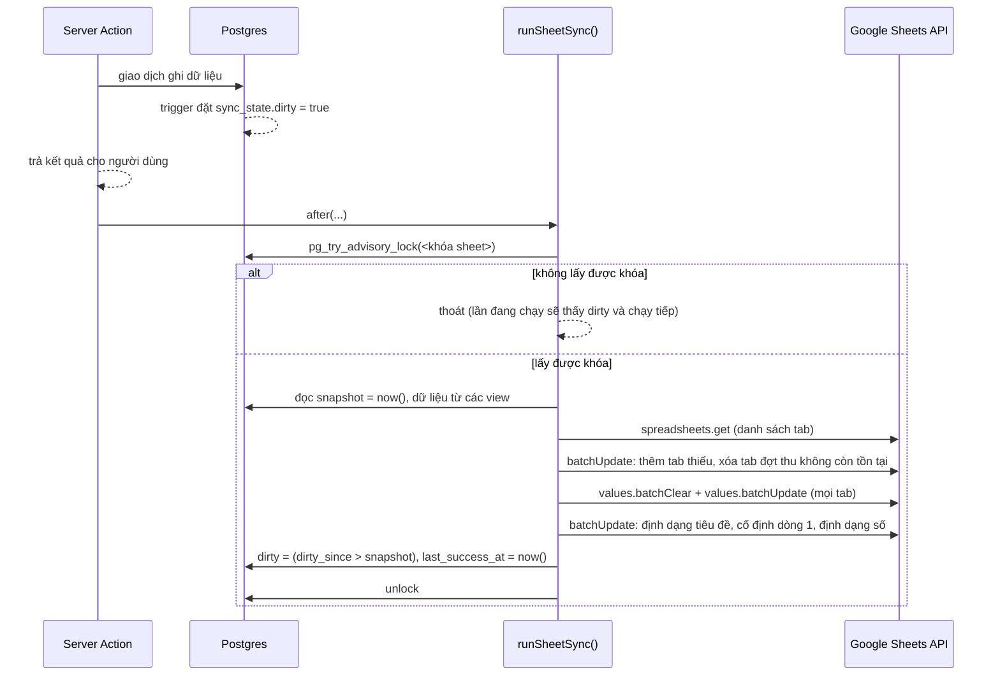

# DESIGN — Thiết kế hệ thống

> Hệ thống: Web app quản lý đội bóng & quỹ đội (N88)
> Phiên bản: 1.0 · Cập nhật: 2026-10-26
> Tài liệu liên quan: [SRS.md](SRS.md) (yêu cầu), [PROPOSAL.md](PROPOSAL.md) (định hướng)

Tài liệu này mô tả cách hiện thực các yêu cầu trong SRS. Mỗi quyết định quan trọng đều ghi kèm lý do; khi code đi khác thiết kế, cập nhật tài liệu này trước.

---

## 1. Kiến trúc tổng thể



### 1.1. Các quyết định chính

| # | Quyết định | Lý do |
|---|---|---|
| D-01 | Một ứng dụng Next.js duy nhất, render phía server, ghi dữ liệu bằng Server Actions | Không cần API riêng; mọi logic và kiểm tra quyền nằm ở server (NFR-04) |
| D-02 | Supabase chỉ dùng cho **Auth, Postgres, Storage**. Trình duyệt **không** truy vấn database trực tiếp | Một điểm kiểm tra quyền duy nhất ở server, dễ test hơn so với dàn đều logic quyền vào RLS policy |
| D-03 | Truy cập DB bằng Drizzle qua kết nối server (`DATABASE_URL`). RLS bật trên mọi bảng, **không có policy** cho `anon`/`authenticated` | RLS đóng vai trò lưới an toàn: lỡ lộ anon key thì cũng không đọc được dữ liệu |
| D-04 | Số đã đóng, còn thiếu, trạng thái khoản, số dư quỹ tính bằng **view Postgres** | Dashboard, trang công khai, Google Sheet cùng đọc một nguồn, không lệch nhau (BR-01, BR-03) |
| D-05 | Nhật ký ghi bằng **trigger Postgres**, người thực hiện truyền qua biến phiên giao dịch | Không thể quên ghi nhật ký khi thêm tính năng mới (FR-AUD-01, BR-16) |
| D-06 | Google Sheet là bản sao một chiều, ghi lại toàn bộ mỗi lần đồng bộ | Không phải so sánh từng dòng; không thể lệch lâu dài (BR-17) |
| D-07 | QR động lấy ảnh từ `img.vietqr.io` | Miễn phí, không cần kết nối ngân hàng |

---

## 2. Mô hình dữ liệu

### 2.1. ERD



### 2.2. DDL

Bảng được khai báo trong `src/server/db/schema.ts` (Drizzle). View, trigger, RLS nằm trong các file migration SQL viết tay. DDL dưới đây là bản tham chiếu.

```sql
-- ===== Enum =====
create type member_type       as enum ('regular', 'student');
create type member_status     as enum ('active', 'inactive');
create type member_role       as enum ('captain', 'vice', 'member');
create type player_position   as enum ('GK', 'DF', 'MF', 'FW');
create type pricing_mode      as enum ('by_type', 'flat', 'manual');
create type collection_status as enum ('open', 'closed');
create type payment_status    as enum ('pending', 'confirmed', 'rejected', 'cancelled');
create type payment_source    as enum ('member_report', 'admin_record');

-- ===== Thành viên =====
create sequence member_code_seq;

create table members (
  id            uuid primary key default gen_random_uuid(),
  code          text not null unique
                default 'M' || lpad(nextval('member_code_seq')::text, 3, '0'),
  user_id       uuid unique references auth.users (id) on delete set null,
  name          text not null check (length(trim(name)) > 0),
  email         text unique check (email = lower(email)),
  phone         text,
  jersey_number smallint check (jersey_number between 0 and 99),
  position      player_position,
  member_type   member_type   not null default 'regular',
  status        member_status not null default 'active',
  role          member_role   not null default 'member',
  created_at    timestamptz not null default now(),
  updated_at    timestamptz not null default now()
);

-- BR-05: số áo không trùng giữa thành viên đang Hoạt động
create unique index members_jersey_active_uq
  on members (jersey_number)
  where status = 'active' and jersey_number is not null;

-- ===== Cài đặt (một dòng duy nhất) =====
create table settings (
  id                  smallint primary key default 1 check (id = 1),
  team_name           text   not null default 'N88',
  transfer_prefix     text   not null default 'N88' check (transfer_prefix ~ '^[A-Z0-9]{2,6}$'),
  bank_bin            text,                 -- mã BIN ngân hàng theo chuẩn VietQR
  bank_name           text,
  account_no          text,
  account_name        text,                 -- tên chủ tài khoản, viết hoa không dấu
  qr_mode             text   not null default 'dynamic' check (qr_mode in ('dynamic', 'static')),
  static_qr_path      text,
  default_fee_regular bigint not null default 200000 check (default_fee_regular > 0),
  default_fee_student bigint not null default 100000 check (default_fee_student > 0),
  sheet_id            text,
  updated_at          timestamptz not null default now()
);

-- ===== Đợt thu =====
create table collections (
  id           uuid primary key default gen_random_uuid(),
  code         text not null unique check (code ~ '^[A-Z0-9]{3,8}$'),   -- BR-10
  title        text not null,
  due_date     date,
  note         text,
  pricing_mode pricing_mode not null,
  fee_regular  bigint,              -- lưu lại để tham khảo, không dùng để tính lại
  fee_student  bigint,
  flat_amount  bigint,
  status       collection_status not null default 'open',
  created_by   uuid not null references members (id),
  created_at   timestamptz not null default now(),
  closed_at    timestamptz
);

-- ===== Khoản phải đóng =====
create table charges (
  id            uuid primary key default gen_random_uuid(),
  collection_id uuid not null references collections (id) on delete cascade,
  member_id     uuid not null references members (id) on delete restrict,
  amount        bigint not null check (amount > 0 and amount <= 100000000),  -- BR-09
  note          text,
  waived_at     timestamptz,
  waived_by     uuid references members (id),
  created_at    timestamptz not null default now(),
  unique (collection_id, member_id)                                          -- BR-04
);

-- ===== Thanh toán =====
create table payments (
  id            uuid primary key default gen_random_uuid(),
  member_id     uuid not null references members (id) on delete restrict,
  total_amount  bigint not null check (total_amount > 0 and total_amount <= 100000000),
  transfer_code text not null check (length(transfer_code) <= 25),            -- BR-12
  is_bundle     boolean not null default false,
  status        payment_status not null,
  source        payment_source not null,
  proof_path    text,
  note          text,
  reject_reason text,
  cancel_reason text,
  created_by    uuid not null references members (id),
  created_at    timestamptz not null default now(),
  reviewed_by   uuid references members (id),
  reviewed_at   timestamptz,
  cancelled_by  uuid references members (id),
  cancelled_at  timestamptz,
  check (status <> 'rejected'  or reject_reason is not null),
  check (status <> 'cancelled' or cancel_reason is not null)
);

create index payments_status_idx on payments (status, created_at);
create index payments_member_idx on payments (member_id, created_at desc);

create table payment_items (
  payment_id uuid not null references payments (id) on delete cascade,
  charge_id  uuid not null references charges (id) on delete restrict,
  amount     bigint not null check (amount > 0),
  pending    boolean not null,   -- bản sao của payments.status = 'pending', do trigger duy trì
  primary key (payment_id, charge_id)
);

-- BR-13: mỗi khoản tối đa một thanh toán đang chờ
create unique index payment_items_one_pending_uq
  on payment_items (charge_id) where pending;

create index payment_items_charge_idx on payment_items (charge_id);

-- ===== Khoản chi =====
create table expense_categories (
  id         uuid primary key default gen_random_uuid(),
  name       text not null unique,
  is_hidden  boolean not null default false,
  sort_order smallint not null default 0
);

create table expenses (
  id            uuid primary key default gen_random_uuid(),
  title         text not null,
  amount        bigint not null check (amount > 0 and amount <= 100000000),
  spent_on      date not null,
  category_id   uuid not null references expense_categories (id) on delete restrict,
  spent_by      uuid references members (id),
  receipt_path  text,
  note          text,
  created_by    uuid not null references members (id),
  created_at    timestamptz not null default now(),
  updated_at    timestamptz not null default now(),
  deleted_at    timestamptz,
  deleted_by    uuid references members (id),
  delete_reason text,
  check (deleted_at is null or delete_reason is not null)
);

create index expenses_spent_on_idx on expenses (spent_on desc) where deleted_at is null;

-- ===== Nhật ký =====
create table audit_logs (
  id         bigint generated always as identity primary key,
  actor_id   uuid,              -- cố ý không đặt FK: nhật ký phải tồn tại kể cả khi thành viên bị xóa
  action     text not null,      -- vd 'payment.confirm'; mặc định '<bảng>.<insert|update|delete>'
  entity     text not null,      -- tên bảng
  entity_id  text not null,
  before     jsonb,
  after      jsonb,
  reason     text,
  created_at timestamptz not null default now()
);

create index audit_logs_entity_idx on audit_logs (entity, entity_id, created_at desc);
create index audit_logs_created_idx on audit_logs (created_at desc);

-- ===== Trạng thái đồng bộ Sheet (một dòng duy nhất) =====
create table sync_state (
  id              smallint primary key default 1 check (id = 1),
  dirty           boolean not null default true,
  dirty_since     timestamptz,
  last_success_at timestamptz,
  last_error      text,
  last_error_at   timestamptz
);
```

### 2.3. View tính toán

```sql
-- Trạng thái từng khoản phải đóng (BR-03)
create view v_charge_status as
with agg as (
  select
    c.id as charge_id,
    coalesce(sum(pi.amount) filter (where p.status = 'confirmed'), 0) as paid,
    coalesce(bool_or(p.status = 'pending'), false)                    as has_pending
  from charges c
  left join payment_items pi on pi.charge_id = c.id
  left join payments p       on p.id = pi.payment_id
  group by c.id
)
select
  c.id as charge_id, c.collection_id, c.member_id, c.amount,
  a.paid,
  case when c.waived_at is not null then 0 else c.amount - a.paid end as remaining,
  a.has_pending,
  case
    when c.waived_at is not null then 'waived'
    when a.paid >= c.amount      then 'paid'
    when a.has_pending           then 'pending'
    when a.paid > 0              then 'partial'
    else                              'unpaid'
  end as status
from charges c
join agg a on a.charge_id = c.id;

-- Tiến độ đợt thu
create view v_collection_progress as
select
  col.id as collection_id, col.code, col.title, col.status, col.due_date,
  count(cs.charge_id)                                        as member_count,
  count(*) filter (where cs.status in ('paid', 'waived'))    as done_count,
  coalesce(sum(cs.amount) filter (where cs.status <> 'waived'), 0) as total_due,
  coalesce(sum(cs.paid), 0)                                  as total_paid
from collections col
left join v_charge_status cs on cs.collection_id = col.id
group by col.id;

-- Tổng nợ theo thành viên
create view v_member_debt as
select m.id as member_id, m.name, m.jersey_number, m.status,
       coalesce(sum(cs.remaining), 0) as debt
from members m
left join v_charge_status cs on cs.member_id = m.id
group by m.id;

-- Số dư quỹ (BR-01)
create view v_fund_balance as
select
  (select coalesce(sum(total_amount), 0) from payments where status = 'confirmed') as total_in,
  (select coalesce(sum(amount), 0) from expenses where deleted_at is null)         as total_out,
  (select coalesce(sum(total_amount), 0) from payments where status = 'confirmed')
  - (select coalesce(sum(amount), 0) from expenses where deleted_at is null)       as balance;
```

Bản hiện thực (`drizzle/0001_db_logic.sql`) có thêm hai điểm so với đoạn trên:
- Mọi view tạo với `with (security_invoker = true)`. Thiếu tùy chọn này, view chạy bằng quyền chủ sở hữu và `anon` có thể đọc vòng qua RLS của bảng gốc.
- Các cột tổng được ép `::bigint`, vì `sum(bigint)` trong Postgres trả về `numeric` và driver sẽ trả chuỗi thay vì số.

Với quy mô ~1.500 thanh toán/năm, view thường chạy trong vài mili-giây; chưa cần materialized view. Nếu sau này chậm, chuyển `v_charge_status` sang materialized view làm mới bằng trigger.

### 2.4. Trigger

```sql
-- Giữ payment_items.pending khớp với payments.status (phục vụ BR-13)
-- (1) khi chèn item: lấy theo trạng thái hiện tại của payment
create function set_item_pending() returns trigger language plpgsql as $$
begin
  select p.status = 'pending' into new.pending from payments p where p.id = new.payment_id;
  return new;
end $$;

create trigger payment_items_pending_on_insert
  before insert on payment_items
  for each row execute function set_item_pending();

-- (2) khi payment đổi trạng thái: cập nhật mọi item của nó
create function sync_payment_items_pending() returns trigger language plpgsql as $$
begin
  update payment_items set pending = (new.status = 'pending')
  where payment_id = new.id;
  return null;
end $$;

create trigger payments_status_to_items
  after update of status on payments
  for each row when (old.status is distinct from new.status)
  execute function sync_payment_items_pending();

-- Đánh dấu cần đồng bộ Sheet khi dữ liệu liên quan thay đổi
create function mark_sheet_dirty() returns trigger language plpgsql as $$
begin
  update sync_state
     set dirty = true, dirty_since = coalesce(dirty_since, now())
   where id = 1;
  return null;
end $$;

create trigger sheet_dirty after insert or update or delete on payments
  for each statement execute function mark_sheet_dirty();
-- tương tự cho: charges, collections, expenses, expense_categories, members
```

Trigger nhật ký mô tả ở [§9](#9-nhật-ký-audit).

### 2.5. Dữ liệu khởi tạo
- `settings`: một dòng với giá trị mặc định.
- `sync_state`: một dòng.
- `expense_categories`: Sân, Nước, Áo, Khác.
- Thành viên Đội trưởng đầu tiên: tạo bằng script `npm run seed:captain -- --name ... --email ...`.

---

## 3. Máy trạng thái

### 3.1. Thanh toán (BR-18)



| Từ | Đến | Ai | Server Action | Điều kiện kiểm tra |
|---|---|---|---|---|
| — | `pending` | Thành viên (*own*) | `reportPayment` | BR-11, BR-13, BR-14; khoản thuộc về người báo, chưa miễn |
| — | `confirmed` | Admin | `recordPayment` | BR-11; khoản thuộc về thành viên được chọn, chưa miễn |
| `pending` | `confirmed` | Admin | `confirmPayment` | BR-11 tính lại lúc xác nhận |
| `pending` | `rejected` | Admin | `rejectPayment` | có lý do |
| `pending` | (xóa) | Thành viên (*own*) | `withdrawPayment` | đúng chủ sở hữu |
| `confirmed` | `cancelled` | Đội trưởng | `cancelPayment` | có lý do |

### 3.2. Khoản phải đóng
Trạng thái được suy ra từ `v_charge_status` (BR-03), không lưu. Các thao tác thay đổi trực tiếp trên khoản:

| Thao tác | Ai | Điều kiện |
|---|---|---|
| Miễn (`waived_at = now()`) | Đội trưởng | Không có `payment_items` nào thuộc thanh toán `pending` hoặc `confirmed` |
| Bỏ miễn | Đội trưởng | Đang được miễn |
| Điều chỉnh số tiền | Đội trưởng | Số mới ≥ `paid` (BR-11) |
| Bỏ khỏi đợt (xóa) | Admin | Đợt đang mở, khoản không có `payment_items` nào (kể cả của thanh toán `rejected`, vì FK `on delete restrict` giữ lại lịch sử) |

---

## 4. Phân quyền

### 4.1. Nguyên tắc
1. Mọi Server Action và Route Handler bắt đầu bằng một hàm guard; không có ngoại lệ.
2. Guard đọc phiên Supabase, tìm thành viên theo `user_id`, rồi kiểm tra vai trò và trạng thái (BR-06).
3. Giao diện ẩn nút theo quyền chỉ để dễ dùng; quyết định cuối cùng luôn ở server (NFR-04).

```ts
// src/server/auth/guards.ts
type Actor = { memberId: string; role: 'captain' | 'vice' | 'member'; active: boolean };

getActor(): Promise<Actor | null>       // null khi chưa đăng nhập hoặc không phải thành viên
requireMember(): Promise<Actor>         // mọi thành viên đã đăng nhập, kể cả Không hoạt động
requireAdmin(): Promise<Actor>          // captain | vice, và đang Hoạt động
requireCaptain(): Promise<Actor>        // captain, và đang Hoạt động
```

### 4.2. Bảng quyền trong code
Ma trận ở [SRS §6](SRS.md#6-ma-trận-phân-quyền) được hiện thực bằng một bảng duy nhất `src/server/auth/permissions.ts`, map từng action tới guard tương ứng. Test integration duyệt bảng này để chắc mỗi action đều từ chối đúng vai trò.

### 4.3. Database
- RLS bật trên mọi bảng trong schema `public`, không tạo policy nào cho `anon` và `authenticated`.
- Server kết nối bằng `DATABASE_URL` với role sở hữu bảng (`postgres`), vốn không bị RLS áp dụng, qua connection pooler ở chế độ transaction; Drizzle cấu hình `prepare: false` cho tương thích pooler.
- `audit_logs` được bảo vệ bằng trigger chặn sửa/xóa (§9.2), không dựa vào `revoke`, vì role sở hữu bảng có thể tự cấp lại quyền.

### 4.4. Storage
- Hai bucket riêng tư: `proofs` (ảnh chuyển khoản) và `receipts` (ảnh hóa đơn), cộng bucket `public-assets` cho ảnh QR tĩnh.
- Đường dẫn: `proofs/<memberId>/<uuid>.jpg`, `receipts/<uuid>.jpg`.
- Tải lên: server cấp signed upload URL sau khi kiểm tra quyền; trình duyệt nén ảnh (≤ 1600px, ~200KB) rồi tải thẳng lên Storage.
- Server Action nhận `proof_path` phải kiểm tra đường dẫn bắt đầu bằng `proofs/<memberId của actor>/` (hoặc của thành viên được ghi hộ khi actor là Admin).
- Xem ảnh: server cấp signed URL có hạn 5 phút sau khi kiểm tra FR-PAY-11.

---

## 5. Server Actions

### 5.1. Quy ước
- Input kiểm tra bằng Zod; schema đặt cạnh action.
- Kết quả trả về:

```ts
type ActionResult<T> =
  | { ok: true; data: T }
  | { ok: false; code: ErrorCode; message: string; field?: string };
```

- Mọi action ghi dữ liệu chạy trong `withActor(actor, { action, reason }, async (tx) => ...)` (xem §9). Hàm này mở giao dịch, gắn thông tin nhật ký, và gọi `revalidatePath` cho các trang bị ảnh hưởng khi thành công.
- Sau khi giao dịch thành công, action gọi `after(() => runSheetSync())` để đồng bộ Sheet mà không làm chậm phản hồi (§7).

### 5.2. Mã lỗi

| Mã | Ý nghĩa |
|---|---|
| `UNAUTHENTICATED` | Chưa đăng nhập |
| `FORBIDDEN` | Không đủ quyền |
| `VALIDATION` | Dữ liệu vào không hợp lệ (kèm `field`) |
| `NOT_FOUND` | Không tìm thấy đối tượng |
| `CONFLICT` | Vi phạm ràng buộc duy nhất (số áo, email, mã đợt, khoản đang chờ…) |
| `ALREADY_PROCESSED` | Thanh toán đã được người khác xử lý |
| `RULE_VIOLATION` | Vi phạm quy tắc nghiệp vụ (kèm mã BR trong `message`) |

### 5.3. Danh sách action

| Action | Guard | Input chính | FR |
|---|---|---|---|
| `createMember` | Admin | name, email?, phone?, jersey?, position?, memberType, role | MEM-02 |
| `updateMember` | Admin | id, các trường như trên | MEM-03 |
| `setMemberStatus` | Admin | id, status | MEM-04 |
| `setMemberRole` | Admin (+BR-07, BR-08) | id, role | MEM-05 |
| `deleteMember` | Captain | id | MEM-07 |
| `previewCollection` | Admin | pricingMode, fees, memberIds | COL-02 (bước 4, không ghi DB) |
| `createCollection` | Admin | code, title, dueDate?, note?, pricingMode, fees, lines[{memberId, amount}] | COL-02 |
| `addCollectionMember` | Admin | collectionId, memberId, amount | COL-04 |
| `removeCharge` | Admin | chargeId | COL-05 |
| `adjustCharge` | Captain | chargeId, amount, reason | COL-06 |
| `waiveCharge` / `unwaiveCharge` | Captain | chargeId, reason | COL-07 |
| `closeCollection` / `reopenCollection` | Admin | collectionId | COL-08 |
| `deleteCollection` | Captain | collectionId, reason | COL-09 |
| `buildReminderText` | Admin | collectionId? (trống = mọi đợt đang mở) | COL-10 |
| `reportPayment` | Member (*own*) | chargeIds[], amount? (chỉ khi 1 khoản), proofPath? | PAY-02, PAY-03 |
| `withdrawPayment` | Member (*own*) | paymentId | PAY-04 |
| `confirmPayment` | Admin | paymentId | PAY-06 |
| `rejectPayment` | Admin | paymentId, reason | PAY-07 |
| `recordPayment` | Admin | memberId, items[{chargeId, amount}], proofPath?, note? | PAY-08 |
| `cancelPayment` | Captain | paymentId, reason | PAY-09 |
| `createExpense` | Admin | title, amount, spentOn, categoryId, spentBy?, receiptPath?, note? | EXP-02 |
| `updateExpense` | Captain | id, các trường, reason? | EXP-03 |
| `deleteExpense` | Captain | id, reason | EXP-04 |
| `upsertCategory` / `hideCategory` | Captain | id?, name, sortOrder | EXP-05 |
| `updateSettings` | Captain | các trường của `settings` | SET-01..03 |
| `resyncSheet` | Admin | — | SHEET-02 |
| `createUploadUrl` | Member / Admin | kind: proof \| receipt, forMemberId? | PAY-02, EXP-02 |
| `getFileUrl` | theo FR-PAY-11 | path | PAY-11 |

Route Handler:

| Route | Bảo vệ | Mục đích |
|---|---|---|
| `GET /auth/callback` | — | Nhận mã OAuth / magic link, liên kết thành viên (FR-AUTH-02) |
| `POST /api/cron/sheet-sync` | Header `Authorization: Bearer <CRON_SECRET>` | Đồng bộ định kỳ (FR-SHEET-03) |

### 5.4. Xử lý đồng thời

**`confirmPayment`** (FR-PAY-06, NFR-08):

```sql
begin;
  -- 1. khóa các khoản liên quan theo thứ tự id để tránh deadlock
  select c.id, c.amount from charges c
   where c.id in (select charge_id from payment_items where payment_id = $1)
   order by c.id
   for update;

  -- 2. chuyển trạng thái có điều kiện; 0 dòng => ALREADY_PROCESSED
  update payments
     set status = 'confirmed', reviewed_by = $actor, reviewed_at = now()
   where id = $1 and status = 'pending'
  returning id;

  -- 3. kiểm tra BR-11 trên dữ liệu đã khóa; vi phạm => rollback, RULE_VIOLATION
  select charge_id, amount, paid from v_charge_status
   where charge_id in (...) and paid > amount;
commit;
```

**`reportPayment` / `recordPayment`**: khóa các khoản (`for update`, theo thứ tự id), kiểm tra các khoản thuộc đúng thành viên, chưa miễn, còn thiếu > 0, số tiền hợp lệ theo BR-11 và BR-14, rồi chèn `payments` và `payment_items`. Nếu hai yêu cầu cùng lúc chứa một khoản, unique index `payment_items_one_pending_uq` chặn yêu cầu thứ hai và action trả `CONFLICT`.

---

## 6. Màn hình & route

### 6.1. Sơ đồ route

| Route | Quyền | Nội dung | FR |
|---|---|---|---|
| `/` | Công khai | Tổng quan quỹ | PUB-01 |
| `/ledger` | Công khai (bản đầy đủ khi đã đăng nhập) | Sao kê | PUB-02 |
| `/collections/[code]` | Công khai (có tên khi đã đăng nhập) | Tiến độ một đợt | PUB-03, DASH-02 |
| `/login` | — | Đăng nhập Google / email | AUTH-01 |
| `/not-member` | Đã đăng nhập, không phải thành viên | Hướng dẫn liên hệ Admin | AUTH-02 |
| `/me` | Thành viên | Dashboard Thành viên | DASH-02, PAY-01 |
| `/me/pay?charges=<id,id>` | Thành viên | Màn hình thanh toán + QR | PAY-02, PAY-03 |
| `/me/payments` | Thành viên | Lịch sử thanh toán | PAY-04, PAY-10 |
| `/admin` | Admin | Dashboard Admin | DASH-01 |
| `/admin/payments` | Admin | Hàng chờ xác nhận + lịch sử | PAY-05..07, PAY-09 |
| `/admin/payments/new` | Admin | Ghi hộ thanh toán | PAY-08 |
| `/admin/collections` | Admin | Danh sách đợt thu | COL-01 |
| `/admin/collections/new` | Admin | Tạo đợt thu (3 bước) | COL-02 |
| `/admin/collections/[id]` | Admin | Chi tiết đợt | COL-03..10 |
| `/admin/members` | Admin | Danh sách thành viên | MEM-01 |
| `/admin/members/new`, `/admin/members/[id]` | Admin | Thêm / chi tiết, sửa | MEM-02..07 |
| `/admin/expenses`, `/admin/expenses/new` | Admin | Danh sách / ghi khoản chi | EXP-01..04 |
| `/admin/settings` | Admin (sửa: Đội trưởng) | Cài đặt, danh mục chi, đồng bộ Sheet | SET, EXP-05, SHEET-02, 04 |
| `/admin/audit` | Admin | Nhật ký | AUD-02 |

Điều hướng: trên điện thoại dùng thanh tab dưới đáy. Thành viên: *Tổng quan · Khoản của tôi · Sao kê*. Admin: *Dashboard · Duyệt · Đợt thu · Chi · Thêm*.

### 6.2. Wireframe dạng chữ

**`/me` — Dashboard Thành viên**
```
┌──────────────────────────────┐
│ Chào Minh (#10)              │
│ ┌──────────────────────────┐ │
│ │ BẠN CÒN THIẾU  400.000đ  │ │
│ │ • Quỹ T10/2026  200.000đ │ │
│ │ • Quỹ T11/2026  200.000đ │ │
│ │ [ Thanh toán tất cả ]    │ │
│ └──────────────────────────┘ │
│ Quỹ đội hiện có  3.250.000đ  │
│ Đợt đang mở                  │
│  Quỹ T11  ████████░░ 12/18   │
│ Sao kê gần đây ...  [Xem hết]│
└──────────────────────────────┘
```

**`/me/pay` — Thanh toán**
```
┌──────────────────────────────┐
│ Thanh toán 2 khoản           │
│ ┌──────────┐  Số tiền        │
│ │  [ QR ]  │  400.000đ       │
│ └──────────┘                 │
│ Ngân hàng   MB Bank          │
│ Số TK       0123456789 [copy]│
│ Chủ TK      NGUYEN VAN A     │
│ Nội dung    N88 10 G2610 [copy]│
│ [ + Đính ảnh chuyển khoản ]  │
│ [     Tôi đã chuyển      ]   │
└──────────────────────────────┘
```

**`/admin` — Dashboard Admin**
```
┌──────────────────────────────┐
│ ⚠ 3 thanh toán chờ duyệt  →  │
│ Quỹ 3.250.000đ               │
│ T11: Thu 2.400.000 · Chi 900.000│
│ Đợt đang mở                  │
│  Quỹ T11   12/18 · 2,4/3,2tr │
│  Áo 2026    9/20 · 2,2/5,0tr │
│ Nợ nhiều nhất                │
│  #7 Hùng   400.000đ          │
│ [Tạo đợt] [Ghi chi] [Ghi hộ] │
│ [Copy tin nhắc nợ]           │
└──────────────────────────────┘
```

**`/admin/collections/new` — Tạo đợt thu**
- Bước 1 *Thông tin*: tên, mã (gợi ý `Q1126`), hạn, ghi chú.
- Bước 2 *Cách tính & người đóng*: chọn Theo đối tượng / Đồng giá / Nhập tay; danh sách thành viên có checkbox, lọc nhanh "Chọn tất cả Hoạt động".
- Bước 3 *Xem trước*: bảng từng dòng có ô sửa số tiền, tổng phải thu ở cuối, nút **Tạo đợt thu**.

Trạng thái của form giữ ở client; chỉ bước cuối gọi `createCollection`.

---

## 7. Đồng bộ Google Sheet

### 7.1. Thiết lập (một lần)
1. Tạo Google Cloud project, bật Google Sheets API, tạo service account, tải khóa JSON.
2. Đội trưởng tạo **một file Google Sheet trống** trong Drive của mình, chia sẻ quyền **Editor** cho email của service account, rồi dán ID file vào Cài đặt.
3. Đội trưởng đặt chế độ chia sẻ của file là "Người có đường liên kết: Người xem" và chỉ gửi link trong nhóm của đội (BR-15).

> Theo câu hỏi Q4 (app tạo file mới), file nên là file mới, trống; app tự tạo toàn bộ tab và nội dung. File do Đội trưởng tạo chứ không do service account tạo, vì service account không có dung lượng Drive riêng và không thể chuyển quyền sở hữu cho tài khoản cá nhân.

### 7.2. Luồng đồng bộ



- Lỗi ở bất kỳ bước nào: ghi `last_error`, `last_error_at`, giữ `dirty = true`, không ném lỗi ra ngoài (BR-17).
- Một lần đồng bộ gọi khoảng 4–5 request tới Sheets API, thấp hơn nhiều so với giới hạn quota.
- Nếu dữ liệu đổi trong lúc đang đồng bộ, `dirty_since` sẽ mới hơn `snapshot`, nên `dirty` vẫn là `true` và lần chạy sau sẽ đồng bộ tiếp.

### 7.3. Thử lại định kỳ
- `pg_cron` trong Supabase chạy mỗi 10 phút: nếu `sync_state.dirty` là `true` và `dirty_since` cũ hơn 2 phút thì dùng `pg_net` gọi `POST /api/cron/sheet-sync` kèm `CRON_SECRET`.
- Dùng `pg_cron` thay vì Vercel Cron vì gói Hobby của Vercel chỉ cho chạy cron tối đa mỗi ngày một lần.

### 7.4. Bố cục Sheet

| Tab | Cột |
|---|---|
| `Tổng quan` | Chỉ số · Giá trị (Số dư, Tổng thu, Tổng chi, Cập nhật lúc) |
| `Thu` | Ngày xác nhận · Thành viên · Số áo · Số tiền · Các đợt · Nội dung CK · Nguồn (Tự báo / Ghi hộ) |
| `Chi` | Ngày · Tên khoản · Danh mục · Số tiền · Người chi · Ghi chú |
| `<mã đợt>` (vd `Q1126`) | Số áo · Thành viên · Phải đóng · Đã đóng · Còn thiếu · Trạng thái — dòng đầu ghi tên đợt và hạn |

Số tiền ghi dạng số, định dạng `#,##0"đ"`; ngày dạng `dd/mm/yyyy`.

---

## 8. QR và nội dung chuyển khoản

### 8.1. Nội dung CK (BR-12)

```ts
// src/server/services/transfer-code.ts
memberToken(m) = m.jerseyNumber != null ? String(m.jerseyNumber) : m.code   // "10" hoặc "M007"

singleCode(prefix, m, collection)  = `${prefix} ${memberToken(m)} ${collection.code}`      // N88 10 Q1126
bundleCode(prefix, m, date)        = `${prefix} ${memberToken(m)} G${dd}${mm}`            // N88 10 G2610
```

- Mọi phần đã là A–Z, 0–9 nên không cần bỏ dấu. Độ dài tối đa: 6 + 1 + 4 + 1 + 8 = 20 ký tự, dưới giới hạn 25.
- Nội dung CK được tính lúc tạo thanh toán và lưu vào `payments.transfer_code`. Sau này thành viên đổi số áo, lịch sử vẫn đúng.

### 8.2. Gợi ý mã đợt
`Q` + tháng 2 chữ số + năm 2 chữ số theo giờ Việt Nam, ví dụ `Q1126`. Nếu đã trùng, thêm hậu tố `B`, `C`…

### 8.3. QR động
```
https://img.vietqr.io/image/{bank_bin}-{account_no}-compact2.png
  ?amount={số tiền}
  &addInfo={encodeURIComponent(nội dung CK)}
  &accountName={encodeURIComponent(tên chủ TK)}
```
- Danh sách ngân hàng (tên, BIN) lưu tĩnh trong `src/lib/banks.json`, dùng cho ô chọn ngân hàng ở Cài đặt.
- Thẻ `` có `alt` ghi số tiền và nội dung CK; nếu ảnh không tải được, giao diện vẫn còn đủ thông tin chữ và nút copy.

### 8.4. QR tĩnh
Ảnh do Đội trưởng tải lên bucket `public-assets`. Màn hình thanh toán hiển thị ảnh kèm số tiền và nội dung CK có nút copy.

---

## 9. Nhật ký (audit)

### 9.1. Cơ chế
`withActor` mở giao dịch và đặt các biến phiên **chỉ có hiệu lực trong giao dịch đó**:

```ts
// src/server/audit.ts
export async function withActor<T>(
  actor: Actor,
  meta: { action: string; reason?: string },
  fn: (tx: Tx) => Promise<T>,
): Promise<T> {
  return db.transaction(async (tx) => {
    await tx.execute(sql`
      select set_config('app.actor_id', ${actor.memberId}, true),
             set_config('app.action',   ${meta.action},   true),
             set_config('app.reason',   ${meta.reason ?? ''}, true)`);
    return fn(tx);
  });
}
```

Trigger dùng chung ghi nhật ký cho mọi bảng nghiệp vụ:

```sql
create function audit_row() returns trigger language plpgsql as $$
declare
  v_action text := nullif(current_setting('app.action', true), '');
begin
  insert into audit_logs (actor_id, action, entity, entity_id, before, after, reason)
  values (
    nullif(current_setting('app.actor_id', true), '')::uuid,
    coalesce(v_action, tg_table_name || '.' || lower(tg_op)),
    tg_table_name,
    coalesce(to_jsonb(new), to_jsonb(old)) ->> 'id',   -- OLD/NEW là NULL tùy thao tác
    to_jsonb(old),
    to_jsonb(new),
    nullif(current_setting('app.reason', true), '')
  );
  return null;
end $$;

create trigger audit after insert or update or delete on payments
  for each row execute function audit_row();
-- tương tự cho: members, collections, charges, expenses, expense_categories, settings
```

`payment_items` không gắn trigger riêng vì không có cột `id`; nội dung của nó được ghi lại qua bản ghi `payments` cùng giao dịch. Trang nhật ký ghép các bản ghi cùng `action` và cùng thời điểm thành một dòng, ví dụ *"Lan xác nhận thanh toán 400.000đ của #10 Minh"*.

### 9.2. Bảo vệ

```sql
create function forbid_audit_change() returns trigger language plpgsql as $$
begin
  raise exception 'audit_logs chỉ được thêm mới (BR-16)';
end $$;

create trigger audit_logs_append_only
  before update or delete on audit_logs
  for each row execute function forbid_audit_change();

create trigger audit_logs_no_truncate
  before truncate on audit_logs
  for each statement execute function forbid_audit_change();
```

- Các thay đổi ngoài app (sửa tay trong Supabase Studio) vẫn được ghi, với `actor_id` rỗng.

---

## 10. Cấu trúc thư mục

```
n88/
├── docs/                       PROPOSAL, SRS, DESIGN
├── drizzle/                    migration (sinh tự động + SQL viết tay cho view/trigger/RLS)
├── supabase/                   config.toml cho môi trường local
├── scripts/                    seed-captain.ts, backup.sh
├── src/
│   ├── app/
│   │   ├── (public)/           page.tsx, ledger/, collections/[code]/
│   │   ├── login/  not-member/
│   │   ├── auth/callback/route.ts
│   │   ├── me/                 page.tsx, pay/, payments/
│   │   ├── admin/              layout.tsx (requireAdmin), page.tsx,
│   │   │                       members/, collections/, payments/, expenses/, settings/, audit/
│   │   └── api/cron/sheet-sync/route.ts
│   ├── server/
│   │   ├── db/                 client.ts, schema.ts, queries/ (đọc từ view)
│   │   ├── auth/               session.ts, guards.ts, permissions.ts
│   │   ├── actions/            members.ts, collections.ts, payments.ts, expenses.ts,
│   │   │                       settings.ts, uploads.ts
│   │   ├── services/           pricing.ts, transfer-code.ts, reminder.ts (hàm thuần, dễ test)
│   │   ├── sheets/             sync.ts, layout.ts
│   │   └── audit.ts
│   ├── components/
│   │   ├── ui/                 shadcn/ui
│   │   └── money.tsx, status-badge.tsx, qr-card.tsx, progress-bar.tsx, bottom-nav.tsx
│   └── lib/                    format.ts (tiền, ngày), vietqr.ts, banks.json, image-compress.ts
├── tests/
│   ├── unit/  integration/  e2e/
└── .github/workflows/          ci.yml, backup.yml
```

Quy tắc phụ thuộc: `app/` gọi `server/actions` và `server/db/queries`; `server/actions` gọi `services` và `db`; `services` không import gì từ `db` hay `next`.

---

## 11. Triển khai & vận hành

### 11.1. Môi trường

| Môi trường | Ứng dụng | Database |
|---|---|---|
| Local | `npm run dev` | Supabase local (`supabase start`, cần Docker) |
| Production | Vercel (gói Hobby) | Supabase (gói Free) |

### 11.2. Biến môi trường

| Biến | Nơi dùng | Bí mật |
|---|---|---|
| `NEXT_PUBLIC_SUPABASE_URL` | client + server | Không |
| `NEXT_PUBLIC_SUPABASE_ANON_KEY` | client + server (chỉ cho Auth) | Không |
| `SUPABASE_SERVICE_ROLE_KEY` | server (Storage signed URL) | **Có** |
| `DATABASE_URL` | server (Drizzle, qua pooler) | **Có** |
| `GOOGLE_SERVICE_ACCOUNT_EMAIL` | server | Không |
| `GOOGLE_SERVICE_ACCOUNT_KEY` | server | **Có** |
| `CRON_SECRET` | server + `pg_cron` | **Có** |
| `APP_URL` | server (link trong tin nhắc nợ, redirect đăng nhập) | Không |

### 11.3. Migration
- `drizzle-kit generate` sinh migration cho bảng; view, trigger, RLS, grant viết tay thành file SQL riêng trong `drizzle/`.
- Áp dụng bằng `drizzle-kit migrate`, chạy thủ công trước khi deploy bản có thay đổi schema.

### 11.4. Sao lưu (NFR-09)
- GitHub Actions `backup.yml` chạy mỗi tuần: `pg_dump` database production, lưu thành artifact giữ 30 ngày (≈ 4 bản).
- Repo phải ở chế độ **private** vì bản dump chứa thông tin cá nhân thành viên.
- Google Sheet là bản sao dữ liệu tiền dễ đọc, không thay thế được bản sao lưu.

### 11.5. Lưu ý gói miễn phí
- Dự án Supabase gói Free có thể bị tạm dừng khi không có hoạt động trong một thời gian. Theo dõi email cảnh báo của Supabase; nếu bị dừng thì khôi phục trong dashboard.
- Vercel Hobby dành cho mục đích phi thương mại, phù hợp với quỹ đội phong trào.

---

## 12. Chiến lược kiểm thử

| Tầng | Công cụ | Phạm vi |
|---|---|---|
| Unit | Vitest | `services/*`: tính tiền theo 3 cách, nội dung CK, gợi ý mã đợt, tin nhắc nợ, định dạng tiền/ngày |
| Integration | Vitest + Supabase local | Server Actions trên DB thật: mọi BR, guard theo bảng quyền, trigger nhật ký, trigger `pending`, view trạng thái, RLS chặn `anon` |
| E2E | Playwright (viewport điện thoại) | Ba luồng chính ở dưới |

Luồng E2E:
1. Admin tạo đợt thu Theo đối tượng → thành viên đăng nhập, thanh toán một phần → Admin xác nhận → số dư và trạng thái khoản đúng.
2. Thành viên nợ hai đợt → Thanh toán tất cả → Admin từ chối → thành viên thấy lý do → thanh toán lại → Admin xác nhận.
3. Khách mở trang công khai → không thấy tên người đóng; thành viên đăng nhập → thấy tên.

Test bắt buộc cho đồng thời: hai `confirmPayment` song song trên cùng thanh toán → đúng một lần thành công, lần còn lại `ALREADY_PROCESSED`; hai `reportPayment` song song chứa cùng khoản → một lần `CONFLICT`.

Quy ước đặt tên test theo mã yêu cầu để điền bảng truy vết ở [SRS §7](SRS.md#7-truy-vết):

```ts
test('FR-PAY-06 · hai admin xác nhận cùng lúc chỉ một lần có hiệu lực', ...)
test('BR-11 · ghi hộ vượt số còn thiếu bị từ chối', ...)
```

CI (`ci.yml`): lint, typecheck, unit test trên mọi push; integration và E2E chạy với Supabase local trong GitHub Actions.
